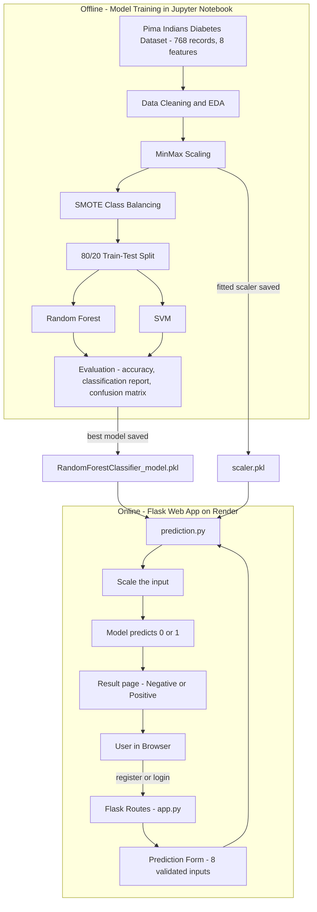

<div align="center">

# 🩺 Diabetes Prediction Using Machine Learning

**A Flask web application that predicts diabetes risk from eight clinical measurements, using a Random Forest classifier trained on the Pima Indians Diabetes dataset.**

[](https://diabetes-prediction-ml-js6j.onrender.com)


[**🚀 Try the live app**](https://diabetes-prediction-ml-js6j.onrender.com) · [**🐛 Report an issue**](https://github.com/Navyachalla21/Diabetes-Prediction-ML/issues)

</div>

> ⏳ **Note:** the app runs on Render's free tier. If it has been idle, the first request can take around 50 seconds while the service wakes up.

---

## 📌 Overview

Diabetes is a chronic condition in which the body cannot properly regulate blood glucose. Early detection helps in managing the disease and avoiding complications, but manual diagnosis is slow and expensive.

This project trains and compares two supervised machine learning models, **Random Forest** and **Support Vector Machine (SVM)**, on the Pima Indians Diabetes dataset and serves the best-performing model through a web interface. A user enters eight medical values and gets an instant prediction.

It was developed as a final-year project for the **Bachelor of Computer Applications (BCA)** degree at The National Degree College, Bagepalli (Bangalore North University), 2022–2023.

## 💡 Why It Matters

Diabetes often develops silently. Many people only find out after complications such as eye, kidney, nerve or heart problems have already started. Knowing the risk early changes what a person can do about it.

A **Positive** result is an early warning. It tells the user that their values look similar to patients who were diagnosed with diabetes, so it is worth getting a proper blood test (such as fasting glucose or HbA1c) and speaking to a doctor, and it is a prompt to look at lifestyle factors like weight, activity and diet.

A **Negative** result means the values look similar to patients without diabetes. It is reassuring, but it does not replace regular health checkups, especially if there is a family history.

**Where a tool like this can help**

- 🏥 **Preliminary screening** in clinics and health camps, to decide who needs a confirmatory lab test first
- 🧑‍⚕️ **Decision support** for doctors, saving time on routine cases
- 🙋 **Self-awareness** for individuals who want a quick risk check before visiting a doctor
- 🎓 **Learning** for students studying how ML is applied to healthcare data

> The model only supports a decision. It does not diagnose. A confirmed diagnosis always needs clinical tests and a qualified doctor.

## ✨ Features

- 🔐 **User accounts:** register, log in, change password and log out
- 🧮 **Instant prediction:** enter eight clinical values and get a Positive or Negative result
- ✅ **Input validation:** every field shows its allowed range
- 📊 **Graphs and model results:** classification reports for the trained models
- ☁️ **Cloud deployed:** served with Gunicorn on Render

## 🏗️ System Architecture

The system has two parts: an **offline training pipeline** that builds the model once, and an **online web app** that uses the saved model to answer user requests.



## 🧠 How It Works

1. **Data:** 768 patient records with 8 features and a binary `Outcome` (1 = diabetic, 0 = not diabetic).
2. **Preprocessing:** checked for null values, explored class balance and age distribution, scaled features with `MinMaxScaler`.
3. **Class imbalance:** the original data has 500 non-diabetic and 268 diabetic records. **SMOTE** oversampling balanced it to 500 / 500.
4. **Training:** stratified 80/20 train/test split, then trained a `RandomForestClassifier` and an `SVC`.
5. **Serving:** the trained model and the scaler are saved with `pickle`. The Flask app scales the user's input with the saved scaler and returns the model's prediction.

## 📈 Results

| Model | Accuracy | Precision | Recall | F1-score |
|---|:---:|:---:|:---:|:---:|
| **Random Forest** | **80.5%** | 0.81 | 0.81 | 0.80 |
| Support Vector Machine | 79.0% | 0.79 | 0.79 | 0.79 |

*Macro-averaged scores on a 200-sample test set. Random Forest performed best and is the model used in the deployed app.*

## 📝 Input Features

| Feature | Allowed range |
|---|---|
| Pregnancies | 0 – 17 |
| Glucose | 0 – 199 |
| Blood Pressure | 0 – 122 |
| Skin Thickness | 0 – 99 |
| Insulin | 0 – 846 |
| BMI | 0.0 – 67.1 |
| Diabetes Pedigree Function | 0.078 – 2.42 |
| Age | 21 – 81 |

## 🛠️ Tech Stack

| Area | Tools |
|---|---|
| Language | Python 3.10 |
| Web framework | Flask, Jinja2 templates, HTML/CSS |
| Machine learning | scikit-learn, imbalanced-learn (SMOTE) |
| Data & plots | pandas, NumPy, Matplotlib, Seaborn |
| Deployment | Gunicorn, Render |

## 📂 Project Structure

```
Diabetes-Prediction-ML/
├── README.md
└── Diabetes_prediction_flask/
    ├── app.py             # Flask routes: login, register, predict, graphs, password
    ├── prediction.py      # Loads model + scaler and returns the prediction
    ├── models/
    │   ├── RandomForestClassifier_model.pkl
    │   └── scaler.pkl
    ├── templates/         # HTML pages
    ├── static/            # CSS, images
    ├── Procfile
    └── requirements.txt
```

## 🚀 Run Locally

```bash
# 1. Clone the repository
git clone https://github.com/Navyachalla21/Diabetes-Prediction-ML.git
cd Diabetes-Prediction-ML/Diabetes_prediction_flask

# 2. Create and activate a virtual environment
python -m venv venv
venv\Scripts\activate          # Windows
# source venv/bin/activate     # macOS / Linux

# 3. Install dependencies
pip install -r requirements.txt

# 4. Start the app
python app.py
```

Then open **http://127.0.0.1:5000** in your browser.

> Use Python 3.10 and the pinned `scikit-learn==1.1.1`. Pickle files are tied to the scikit-learn version they were created with.

## ☁️ Deployment (Render)

| Setting | Value |
|---|---|
| Root Directory | `Diabetes_prediction_flask` |
| Build Command | `pip install gunicorn && pip install -r requirements.txt` |
| Start Command | `gunicorn app:app` |
| Environment variable | `PYTHON_VERSION` = `3.10.11` |

## 🔮 Future Improvements

- Compare more models (XGBoost, Logistic Regression) and a hybrid ensemble
- Hyperparameter tuning with cross-validation
- Store users in a proper database with hashed passwords
- Add explainability, for example feature-importance charts for each prediction
- Train on a larger, more diverse dataset

## ⚠️ Disclaimer

This project is for **educational purposes only**. It is not a medical device and must not be used for diagnosis or treatment decisions. Always consult a qualified healthcare professional.

## 👩‍💻 Author

**Navya Shree K N**
BCA, The National Degree College, Bagepalli (Bangalore North University)

Guided by **Anusha Priyadharshini C**, Head of the Department of Computer Science.

GitHub: [@Navyachalla21](https://github.com/Navyachalla21)

---

<div align="center">

⭐ If you found this project useful, consider giving the repository a star.

</div>
